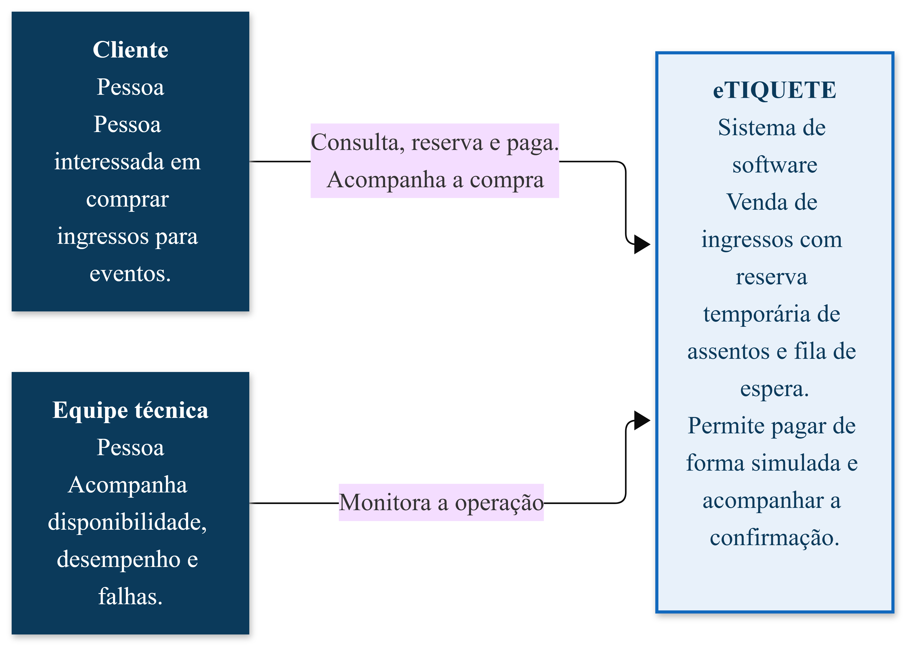
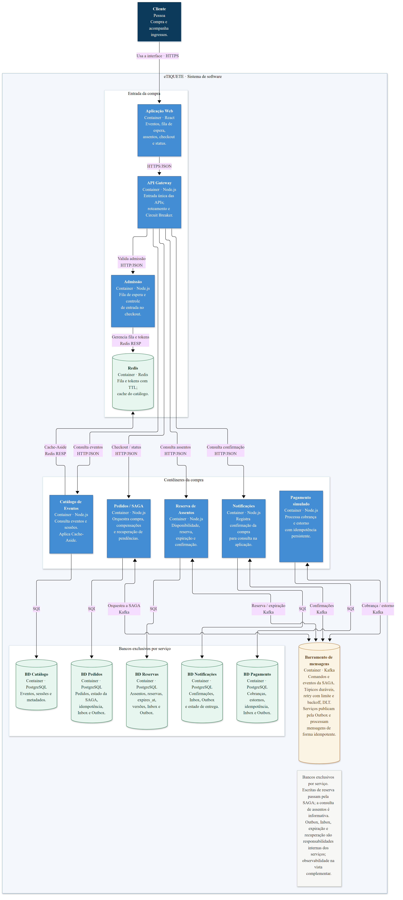
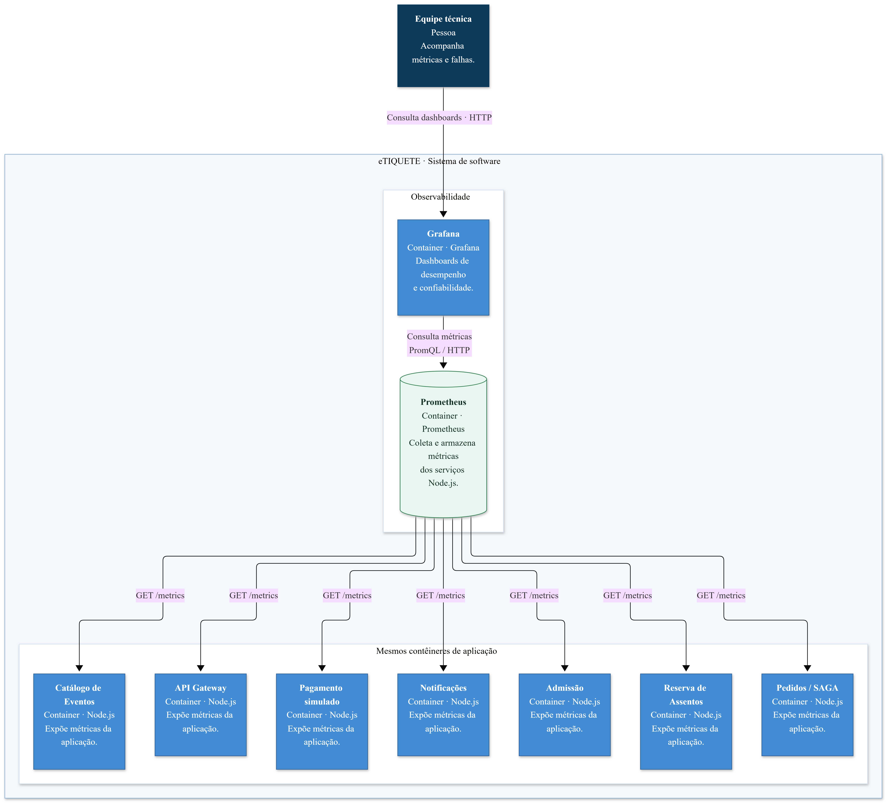

# eTiquete

Este sistema está sendo desenvolvido como projeto final da disciplina de Engenharia de Sistemas Distribuídos. O E-Tiquete é uma plataforma de venda e reserva de ingressos baseada em uma arquitetura de microsserviços, com foco em confiabilidade, concorrência e desempenho.

## Sobre o projeto

O eTiquete busca evitar problemas comuns em vendas de ingressos de alta demanda, como venda duplicada de assentos, cobranças em duplicidade e reservas abandonadas.

A plataforma permite consultar eventos, selecionar e reservar assentos temporariamente, realizar pagamentos simulados e acompanhar a confirmação da compra. Também conta com um mecanismo de fila de espera e controle de admissão ao checkout, limitando a quantidade de usuários que acessam simultaneamente o processo de compra.

Em caso de falha no pagamento ou expiração da reserva, o sistema executa ações compensatórias para liberar os assentos e, quando necessário, estornar pagamentos.

**Serviços e componentes:** Aplicação Web, API Gateway, Admissão, Catálogo de Eventos, Reserva de Assentos, Pedidos (orquestrador da SAGA), Pagamento Simulado, Notificações, Redis e Barramento de Mensagens.

## Objetivos

- Evitar a venda duplicada de assentos.
- Garantir a idempotência das operações de pagamento.
- Liberar reservas expiradas automaticamente.
- Controlar o acesso simultâneo ao checkout por meio de fila de espera.
- Manter a disponibilidade dos serviços diante de falhas.
- Monitorar o desempenho sob alta concorrência.
- Garantir a entrega confiável de eventos entre os serviços.

## Tecnologias

| Tecnologia | Descrição |
|---|---|
| Node.js + React | Desenvolvimento dos microsserviços e da interface web. |
| PostgreSQL | Banco de dados relacional, com persistência exclusiva por serviço. |
| Redis | Cache do catálogo e gerenciamento de tokens temporários da fila de espera. |
| Kafka | Barramento de mensagens para comunicação assíncrona entre os serviços da SAGA. |
| Docker Compose | Execução e integração dos serviços e suas dependências em contêineres. |
| GitHub Actions | Automação de verificações, testes e builds. |
| Testcontainers | Execução de testes de integração com dependências reais em contêineres. |
| Prometheus | Coleta e armazenamento de métricas dos serviços. |
| Grafana | Dashboards e visualização de métricas para monitoramento. |

## Execução local

Para iniciar os contêineres e suas dependências:

```bash
docker compose up -d
```

Para interromper e remover os contêineres, preservando os volumes:

```bash
docker compose down
```

O Compose sobe hoje:

| Serviço | Endereço |
|---|---|
| Frontend | http://localhost:8080/ |
| Backend | http://localhost:8080/api/ |
| Saúde do Nginx | http://localhost:8080/health |
| PostgreSQL | localhost:5432 |
| Kafka | localhost:9092 na máquina; kafka:9092 entre contêineres |

`frontend` e `backend` são imagens construídas no repositório. O Kafka é o broker oficial da arquitetura e já sobe com o Compose.

As configurações de execução e credenciais de desenvolvimento devem ser consultadas no arquivo `.env.example`.

## Diagramas C4

Os três diagramas da entrega 2. A fonte editável é Mermaid; a figura abaixo é o PNG gerado a partir dela. No nível 1 há uma única caixa de sistema, cercada por pessoas. O pagamento simulado é contêiner interno da compra. O barramento é Kafka.

### Nível 1 — Pessoas e escopo da plataforma

Cliente e Equipe técnica usam o eTIQUETE. As setas levam rótulo.



Fonte: [`docs/c4/nivel-1.mmd`](docs/c4/nivel-1.mmd)

### Nível 2 — Vista principal da compra e coordenação distribuída

Contêineres da compra: Aplicação Web, API Gateway, Admissão, Catálogo de Eventos, Reserva de Assentos, Pedidos / SAGA, Pagamento simulado e Notificações. Redis guarda a fila e o cache. Cada serviço tem o próprio PostgreSQL. O barramento Kafka leva reserva, orquestração da SAGA, cobrança e confirmação.



Fonte: [`docs/c4/nivel-2-compra.mmd`](docs/c4/nivel-2-compra.mmd)

### Nível 2 — Vista complementar dos mesmos contêineres de aplicação

A Equipe técnica consulta o Grafana. O Prometheus coleta `GET /metrics` do gateway, da admissão, do catálogo, da reserva, dos pedidos, do pagamento simulado e das notificações.



Fonte: [`docs/c4/nivel-2-complementar.mmd`](docs/c4/nivel-2-complementar.mmd)

## Padrões arquiteturais

O projeto adota os seguintes padrões para garantir a confiabilidade e a coordenação das operações distribuídas:

- **SAGA (orquestração):** coordenação das etapas da compra pelo serviço de Pedidos, com ações compensatórias em caso de falhas.
- **Transactional Outbox:** registro das alterações e mensagens a publicar na mesma transação do banco de dados.
- **Retry e dead letter topic (DLT):** novas tentativas de processamento e encaminhamento de mensagens que esgotaram as tentativas para um tópico de mensagens não entregues.
- **Circuit Breaker:** interrupção temporária de chamadas a serviços com falhas recorrentes.
- **API Gateway:** ponto de entrada para as requisições dos clientes e encaminhamento aos serviços responsáveis.
- **Cache-Aside:** utilização de cache para reduzir consultas repetidas ao banco de dados.
- **Database-per-service:** isolamento dos dados, com banco ou esquema exclusivo para cada microsserviço.

## Status

Em desenvolvimento.

## GitHub Actions

O workflow [`deploy.yml`](.github/workflows/deploy.yml) atualmente apenas valida o Compose, constrói as imagens dos serviços e verifica a saúde da aplicação em um runner do GitHub Actions. Não há deploy automático para servidor neste momento.

As imagens construídas são as imagens locais dos serviços `frontend` e `backend`, definidos no [`docker-compose.yml`](docker-compose.yml). PostgreSQL, Kafka e Nginx utilizam imagens oficiais do Docker Hub.
